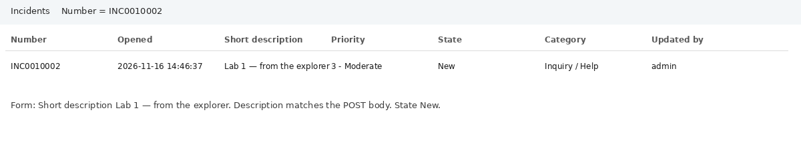
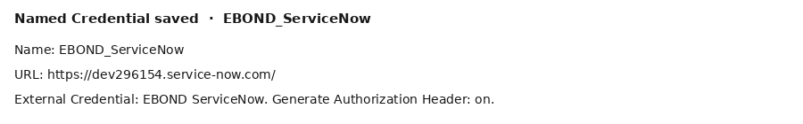
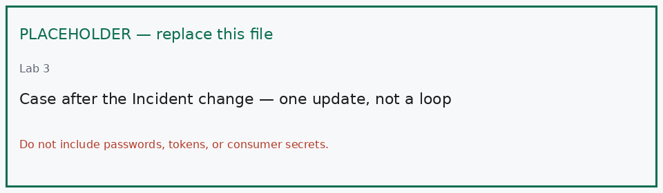
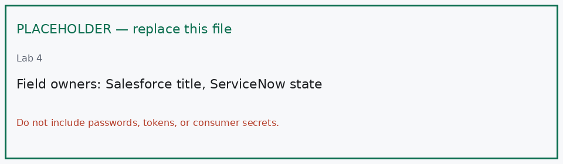
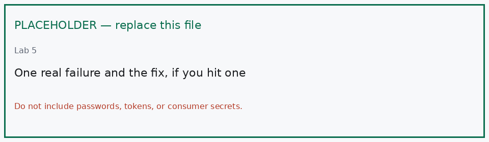

# EBOND lab run — screenshot placeholders

This repo holds the screenshots from one pass through the lab. The boxes below are placeholders. Replace each file with the real capture, same filename, after you finish that step.

Lab: https://eltonaguiar.github.io/EBOND_ServiceNowSalesforce/

Code: https://github.com/eltonaguiar/EBOND_ServiceNowSalesforce

Do not commit passwords, tokens, consumer secrets, or session cookies. Cover them before you save the image.

This README is the page for now. A GitHub Pages site can be added later from these same files; do not turn that on until the placeholders have been replaced.

## Lab 0 — Free instances

| File | What to capture |
|------|-----------------|
| `screenshots/00-pdi-url.png` | Captured. Instance `dev296154`, Australia, Online, user `admin`. Password masked. |
| `screenshots/00-salesforce-mydomain.png` | Captured. Developer Edition welcome on the Lightning host. API host is `orgfarm-e1f47f3d5e-dev-ed.develop.my.salesforce.com`. |

## Lab 1 — Table API

| File | What to capture |
|------|-----------------|
| `screenshots/01-explorer-201.png` | REST API Explorer, POST incident, status 201, INC number visible. |
| `screenshots/01-incident-list.png` | Incident list with that same number. |

## Lab 2 — Salesforce to ServiceNow

| File | What to capture |
|------|-----------------|
| `screenshots/02-case-fields.png` | Case fields `Snow_Sys_Id__c`, `Snow_Number__c`, `Snow_Sync_Source__c`. |
| `screenshots/02-named-credential.png` | Named Credential `EBOND_ServiceNow`. No secret in the frame. |
| `screenshots/02-case-and-incident.png` | The Case, and the Incident whose `u_ebond_sf_case_id` matches the Case Id. |

## Lab 3 — ServiceNow to Salesforce

| File | What to capture |
|------|-----------------|
| `screenshots/03-external-client-app.png` | External Client App. Consumer secret covered. |
| `screenshots/03-rest-message-200.png` | REST Message `patch_case` test, HTTP 200. |
| `screenshots/03-case-after-update.png` | Case after the Incident change. One update, not a stream. |

## Lab 4 — Ownership and loops

| File | What to capture |
|------|-----------------|
| `screenshots/04-ownership.png` | A note or form that shows Salesforce owns the title and ServiceNow owns state. |

## Lab 5 — Troubleshooting

| File | What to capture |
|------|-----------------|
| `screenshots/05-troubleshooting.png` | Optional. One failure you actually hit, and the screen after the fix. Leave the placeholder if the run was clean. |

## Replace a placeholder

1. Take the screenshot.
2. Cover any secret.
3. Save over the file in `screenshots/` with the same name.
4. Commit only that image. Do not commit `.env`, pem files, or browser profiles.
