# EBOND lab run — screenshot placeholders

This repo holds the screenshots from one pass through the lab. The boxes below are placeholders. Replace each file with the real capture, same filename, after you finish that step.

Lab: https://eltonaguiar.github.io/EBOND_ServiceNowSalesforce/

Code: https://github.com/eltonaguiar/EBOND_ServiceNowSalesforce

Do not commit passwords, tokens, consumer secrets, or session cookies. Cover them before you save the image.

This README is the page for now. A GitHub Pages site can be added later from these same files; do not turn that on until the placeholders have been replaced.

## Lab 0 — Free instances

**Why.** Nothing else in the lab can be proven until both free accounts exist and you know the host each API will call. A wrong Salesforce host (Lightning instead of My Domain) fails every later call and looks like an auth bug.

| File | What to capture |
|------|-----------------|
| `screenshots/00-pdi-url.png` | Captured. Instance `dev296154`, Australia, Online, user `admin`. Password masked. |
| `screenshots/00-salesforce-mydomain.png` | Captured. Developer Edition welcome on the Lightning host. API host is `orgfarm-e1f47f3d5e-dev-ed.develop.my.salesforce.com`. |

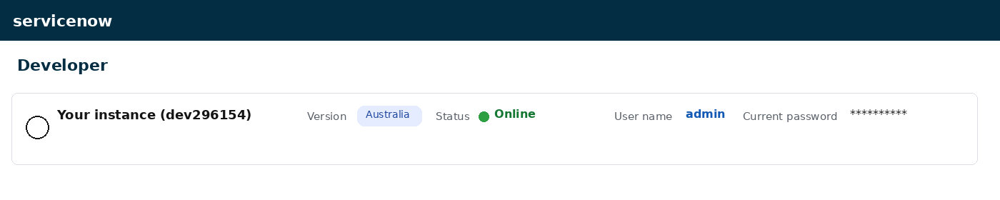

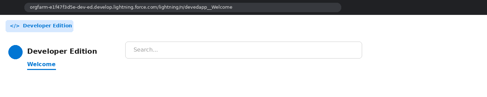

## Lab 1 — Table API

**Why.** This is the smallest proof that ServiceNow accepts an outside create. A 201 and a matching Incident mean the instance, the user, and the table are good before Salesforce is involved. If this fails, do not debug Flow or Apex yet.

| File | What to capture |
|------|-----------------|
| `screenshots/01-explorer-setup.png` | Captured. Namespace `now`, API Name Table API, tableName Incident (`incident`). |
| `screenshots/01-explorer-body.png` | Captured. Raw body filled, before Send. Request format `application/json`, authorization Send as me. |
| `screenshots/01-explorer-201.png` | Captured. Status 201 Created. Number `INC0010002`. sys_id `5dba2bdac3e8df54310abf0d050131a5`. Session token covered. |
| `screenshots/01-incident-list.png` | Captured. Ticket list after the 201. `INC0010002`, opened 2026-11-16 14:46:37, short description "Lab 1 — from the explorer", state New, updated by admin. |

The empty Request Body frame was skipped. After Send, the browser asks "Modifying data, confirm to continue". Click OK. That dialog is expected. It is not the proof. The proof is the 201 and the Incident row.

The explorer sets two headers for you. The captured request shows both as `application/json`:

- `Accept: application/json`
- `Content-Type: application/json`

You must set both yourself later, in curl or in the Salesforce callout. Missing either one returns 400. The explorer will not save you then.

**ELI5.** `Content-Type` is the label on the box you are sending. It says "this box is JSON." `Accept` is the label you want on the box they send back. It says "please answer in JSON." If you forget the label on the way in, ServiceNow does not know how to read the body and returns 400. If you forget the label on the way back, you may get HTML or an empty error instead of the Incident number.

**Properly.** These are HTTP headers, not fields in the JSON body.

- `Content-Type: application/json` tells the server how to parse the request body. The Table API expects a JSON object. Without this header it will not treat `{ "short_description": "..." }` as that object, and the create fails with 400.
- `Accept: application/json` is the response format you will accept. The Table API can negotiate. Asking for JSON is what makes the 201 body a `result` object with `number` and `sys_id`, which is what the later labs read. The explorer sets both to `application/json` in Request format and Response format. A curl call and a Salesforce HTTP callout do not. Copy both headers into those calls.

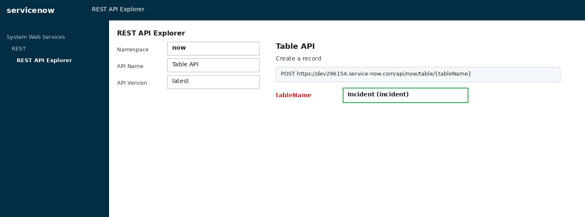

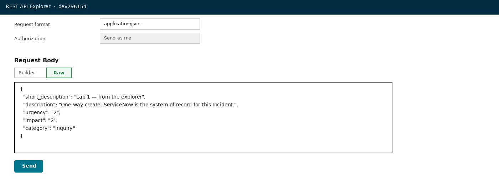

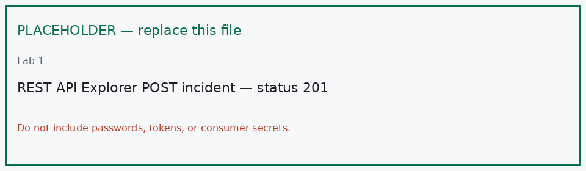

### Windows PowerShell

The Linux `curl` paste fails in PowerShell. `Invoke-RestMethod` with `Read-Host` worked on Windows PowerShell 5.1. `sys_updated_on=2026-11-16 23:12:17`.

The password is not in the command text, but it does stay on the screen after you type it. Cover it before a screenshot, then run `Clear-Host`. The bar in this shot is that cover.

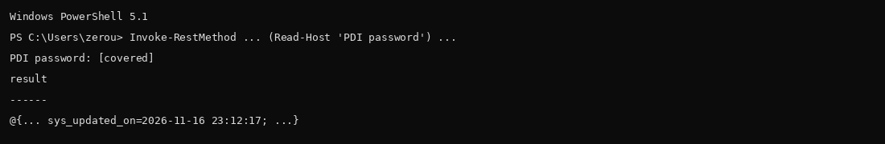

Linux curl — same proof, collapsed

The multi-line `curl` command works in bash. It does not work in PowerShell. This run returned `INC0010007`, sys_id `89e6f3dec32cdf54310abf0d05013123`, `sys_updated_on` `2026-11-16 23:09:16`. The password in the capture is covered.

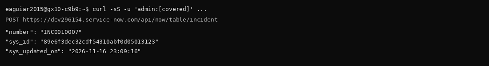

Command Prompt — same proof, collapsed

`curl.exe -u admin` prompts for the password, so Command Prompt never rewrites `%` or `^`. This run returned `INC0010008`, sys_id `5a60bf9ac32cdf54310abf0d05013147`, created `2026-11-16 23:11:32`. No password is in the frame.

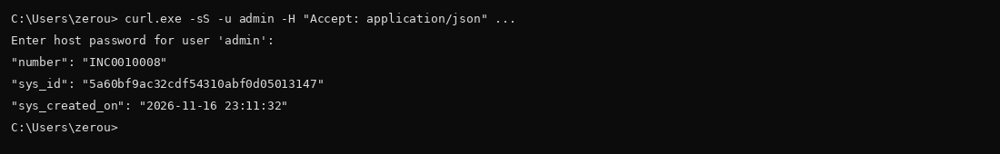

### Second create — INC0010003

A second POST made another Incident. The list does not show `sys_id`. Open the row in the classic form and read it from the URL.

| | |
|--|--|
| Number | `INC0010003` |
| sys_id | `665ce35ac3e8df54310abf0d050131fd` |
| Opened | 2026-11-16 14:53:48 |
| Filter | Number = INC0010003 |

The classic URL was:

`https://dev296154.service-now.com/now/nav/ui/classic/params/target/incident.do%3Fsys_id%3D665ce35ac3e8df54310abf0d050131fd%26sysparm_record_list%3Dnumber%253DINC0010003`

`sys_id%3D` is `sys_id=`. The 32 characters after it are the id. That is the value Lab 2 stores in `Snow_Sys_Id__c`. Do not use the display number `INC0010003` as the sys_id.

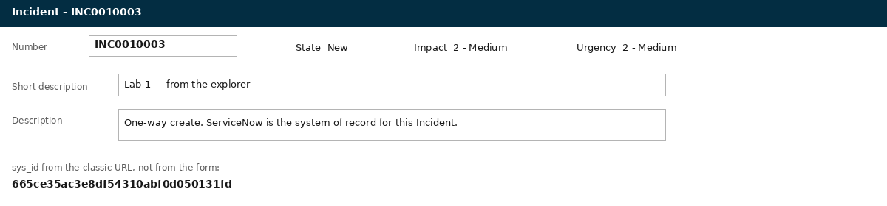

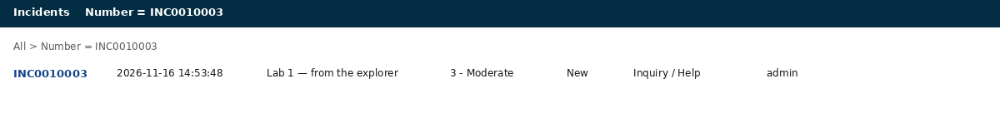

## Lab 2 — Salesforce to ServiceNow

**Why.** This is the first real direction of the integration: a Case save creates one Incident and stores the Case Id on it. The screenshots prove the credential is named, the correlation field is filled, and a second save would update instead of duplicating.

| File | What to capture |
|------|-----------------|
| `screenshots/02-setup-gear.png` | Captured. Gear icon, top right, opens the Setup Menu. |
| `screenshots/02-setup-menu.png` | Captured. Click Setup. Do not click Setup for current app. |
| `screenshots/02-case-field-details.png` | Captured. Step 2 of 4, Enter the details. Field Name `Snow_Sys_Id`, length 32, Unique and External ID checked. |
| `screenshots/02-case-layouts.png` | Captured. Step 4 of 4. All five Case layouts checked, including Case Layout and Close Case Layout. |
| `screenshots/02-case-fields.png` | Captured. All three exist. `Snow_Sys_Id__c` is Text(32), External ID, unique, indexed. `Snow_Number__c` is Text(40). `Snow_Sync_Source__c` is Text(20). |
| `screenshots/02-named-credential-empty.png` | Captured. Quick Find `named credentials`. Empty list. Next click is New. |
| `screenshots/02-external-credential-protocol.png` | Captured. Protocol list. Use Basic Authentication, not Custom. |
| `screenshots/02-external-credential-name.png` | Captured. Save failed. Label may have a space. Name may not. Use `EBOND_ServiceNow`. |
| `screenshots/02-principal-form.png` | Captured. Create Principal. Sequence Number 1. Identity Type Named Principal, not Per User Principal. |
| `screenshots/02-principal-filled.png` | Captured. Same form. Username `admin`. Password covered. |
| `screenshots/02-principal-saved.png` | Captured. Principal saved. Sequence 1, `PDI_admin`, Named Principal, Authentication Status Configured, username `admin`. External Credential name is `EBONDServiceNow`. Related Named Credentials is still empty. |
| `screenshots/02-user-detail.png` | Captured. Top-right picture, then your name, then User Detail. That is the user to assign. |
| `screenshots/02-permission-sets.png` | Captured. Setup, Users, Permission Sets. License stays --None--. |
| `screenshots/02-permset-principal-access.png` | Captured. Permission set `PDI admin`. Next click is External Credential Principal Access, then check `PDI_admin`. Manage Assignments is on this page. |
| `screenshots/02-principal-enabled.png` | Captured. Edit, Add arrow, `EBONDServiceNow - PDI_admin` is in Enabled. Save, then Manage Assignments. |
| `screenshots/02-principal-access-saved.png` | Captured. Saved. Permission set `PDI admin` lists `EBONDServiceNow - PDI_admin`. Next is Manage Assignments. |
| `screenshots/02-permset-assigned.png` | Captured. Add Assignment, user Elton Aguiar, profile System Administrator. One assignment. Expires On blank. |
| `screenshots/02-named-credential-form.png` | Captured. New Named Credential. External Credential EBOND ServiceNow. Generate Authorization Header checked. Name must keep the underscore: `EBOND_ServiceNow`. |
| `screenshots/02-named-credential.png` | Captured. Saved. Name `EBOND_ServiceNow`. URL `https://dev296154.service-now.com/`. External Credential `EBOND ServiceNow`. Generate Authorization Header on. |
| `screenshots/02-flows-home.png` | Captured. Quick Find `flows`. Next click is New Flow, top right. Not an existing row. |
| `screenshots/02-flow-async.png` | Captured. Case, record is created, Actions and Related Records, Add Asynchronous Path on. HTTP call goes on Run Asynchronously. Action is Create HTTP Callout. |
| `screenshots/02-create-http-callout.png` | Captured. Search Actions. The link at the bottom, Create HTTP Callout. Not a category row. |
| `screenshots/02-http-callout-name.png` | Captured. New HTTP Callout. Name `EBONDCreateIncident`, no underscore. Named Credential `EBOND_ServiceNow`. |
| `screenshots/02-http-callout-filled.png` | Captured. Name and Named Credential filled. URL shows the dev instance. Next. |
| `screenshots/02-http-callout-method.png` | Captured. Next screen. Label `Create Incident`, method POST, path `/api/now/table/incident`. No query key. |
| `screenshots/02-case-created.png` | Captured. Case `00001026`, Priority Medium, Status New. The three ServiceNow fields are on the page and empty until the callout runs. |
| `screenshots/02-case-fields-on-page.png` | Captured. The three fields are circled on the Case page: ServiceNow Sys Id, ServiceNow Number, Sync Source. Values empty. Opened 2026-11-16, 11:19 p.m. |
| `screenshots/02-case-and-incident.png` | The Case, and the Incident whose `u_ebond_sf_case_id` matches the Case Id. |

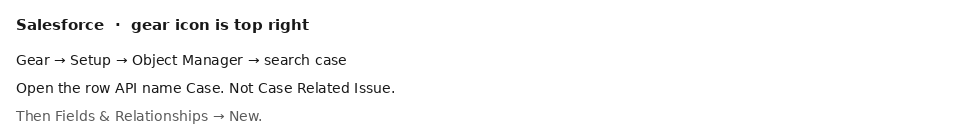

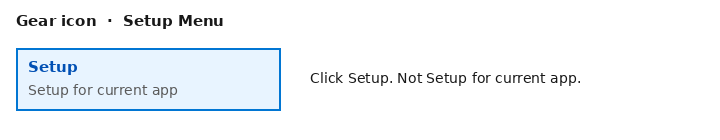

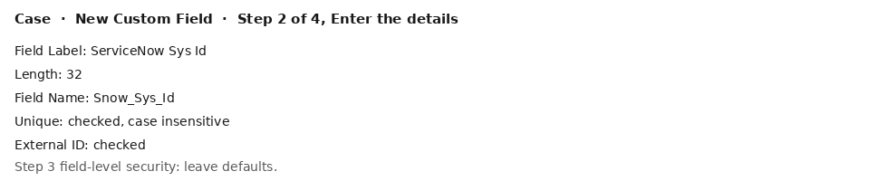

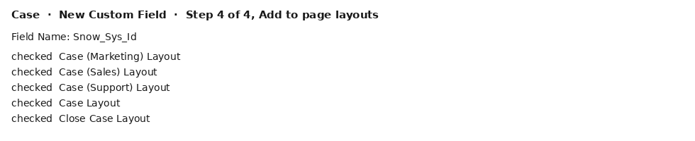

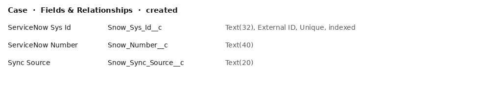

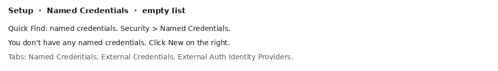

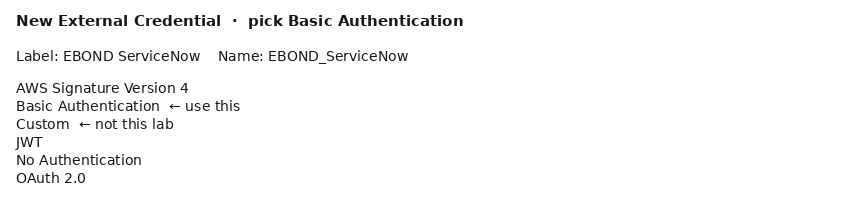

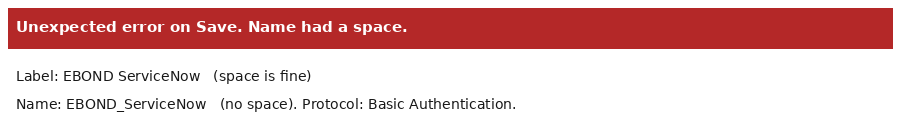

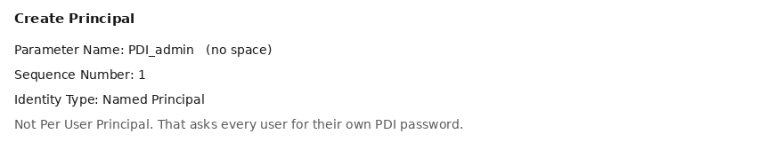

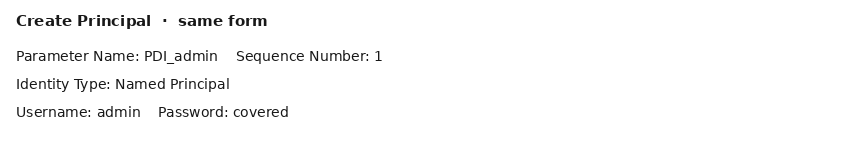

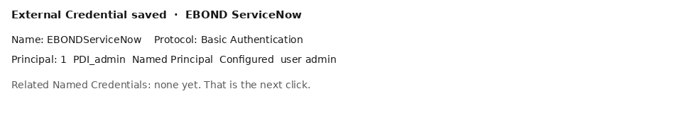

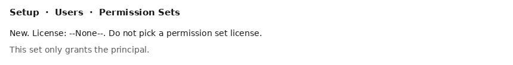

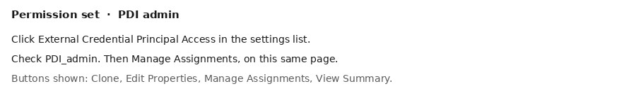

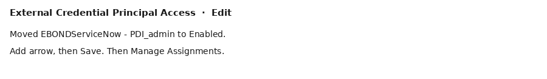

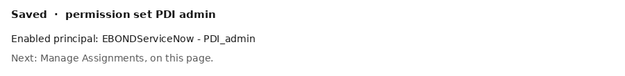

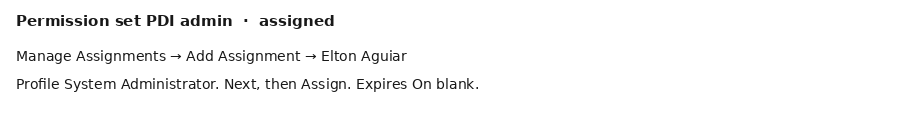

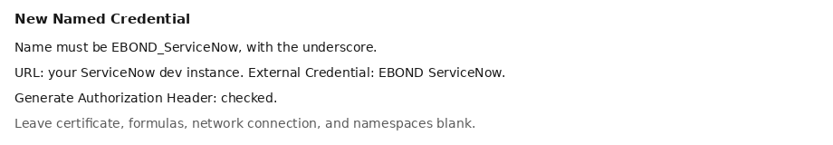

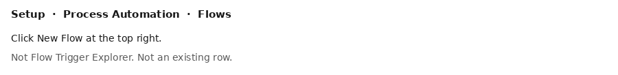

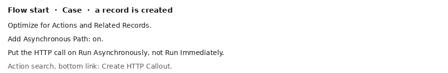

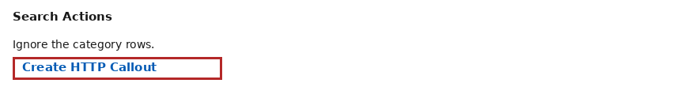

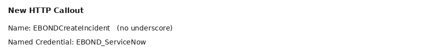

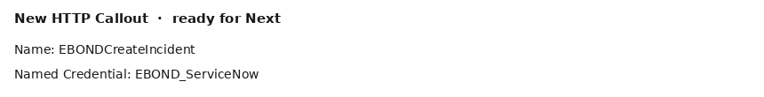

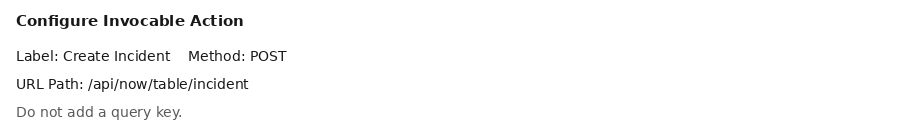

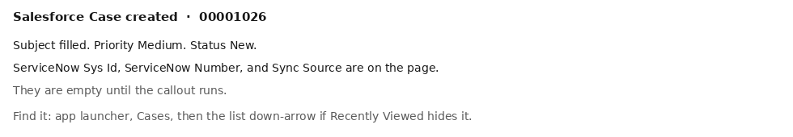

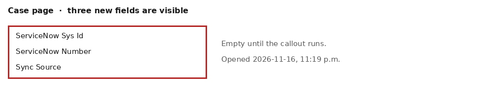

How the Incident column was opened

Added. From Incident INC0010003: form menu → **Configure > Table**. The table is Global, extends Task, and now has 98 columns. Both custom fields are in the list:

| Label | Name | Type | Length |
|-------|------|------|--------|
| EBOND SF Case Id | `u_ebond_sf_case_id` | String | 18 |
| Sync Source | `u_sync_source` | String | 20 |

Not `x_snc_`. That prefix is ServiceNow's.

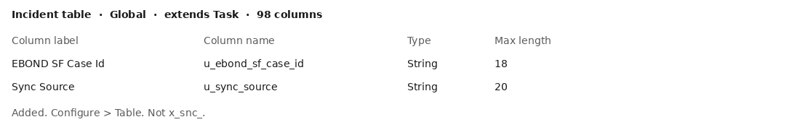

## Lab 3 — ServiceNow to Salesforce

**Why.** One direction is not a bond. This proves ServiceNow can call back and update the same Case, matched by `Snow_Sys_Id__c`, instead of creating a second Case. The 200 and the single Case update are the proof.

| File | What to capture |
|------|-----------------|
| `screenshots/03-external-client-app.png` | External Client App. Consumer secret covered. |
| `screenshots/03-rest-message-200.png` | REST Message `patch_case` test, HTTP 200. |
| `screenshots/03-case-after-update.png` | Case after the Incident change. One update, not a stream. |

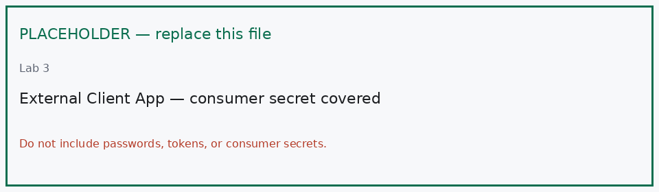

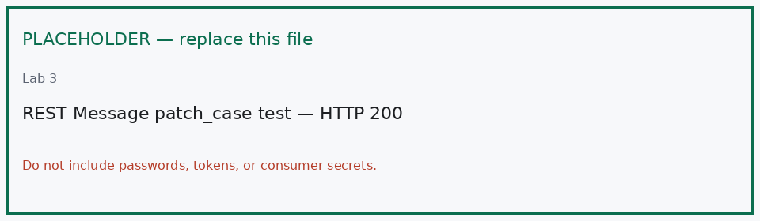

## Lab 4 — Ownership and loops

**Why.** Bidirectional sync fails in production when both sides copy every field. This lab is where you show which system owns the title and which owns state, and that one save does not bounce forever.

| File | What to capture |
|------|-----------------|
| `screenshots/04-ownership.png` | A note or form that shows Salesforce owns the title and ServiceNow owns state. |

## Lab 5 — Troubleshooting

**Why.** A clean run does not need a shot. If something failed, the before-and-after is the evidence that the failure was diagnosed (asleep instance, wrong host, missing principal access, callout before the save committed) and not papered over.

| File | What to capture |
|------|-----------------|
| `screenshots/05-troubleshooting.png` | Optional. One failure you actually hit, and the screen after the fix. Leave the placeholder if the run was clean. |

## Also useful

Not required. Take these if the screen is already open.

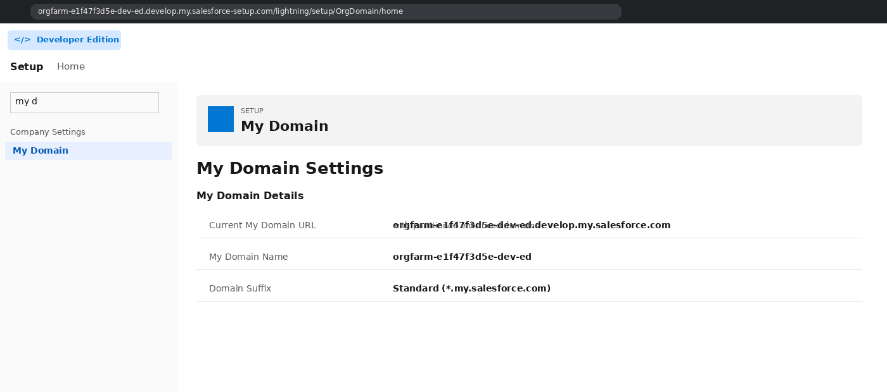

| Suggested file | Why |
|----------------|-----|
| `screenshots/00-my-domain.png` | Captured. Current My Domain URL `orgfarm-e1f47f3d5e-dev-ed.develop.my.salesforce.com`. |
| `screenshots/02-principal-access.png` | Permission set granting External Credential Principal Access. This is the usual Lab 2 miss. |
| `screenshots/02-incident-fields.png` | Incident columns `u_ebond_sf_case_id` and `u_sync_source`. |
| `screenshots/04-syslog-one-write.png` | `syslog.list` filtered to EBOND, one write, not a loop. |

## Replace a placeholder

1. Take the screenshot.
2. Cover any secret.
3. Save over the file in `screenshots/` with the same name.
4. Commit only that image. Do not commit `.env`, pem files, or browser profiles.
